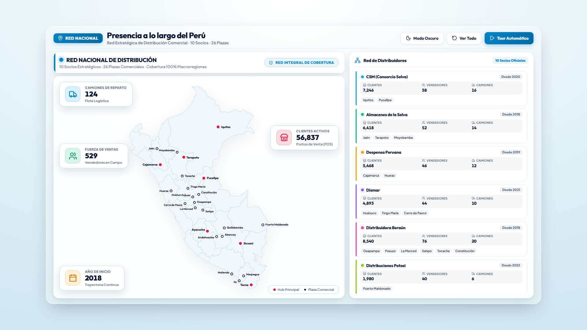
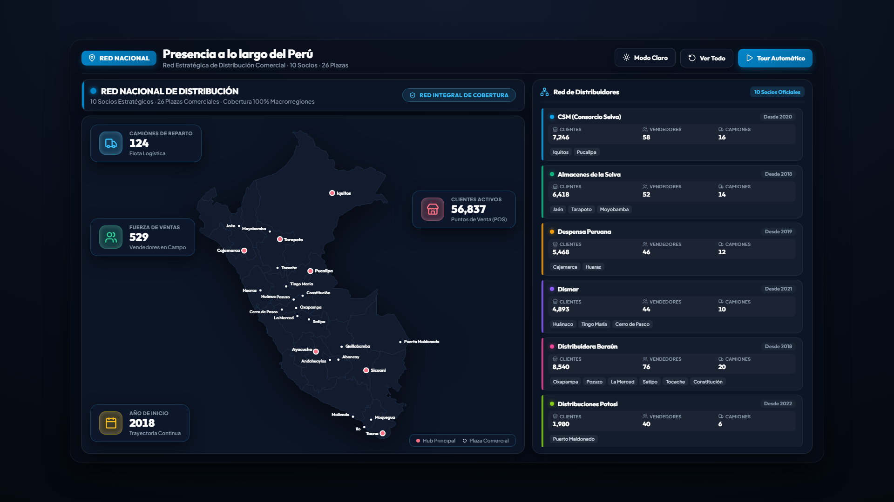

# 🇵🇪 Red Nacional de Distribución Comercial — Presentación Ejecutiva Interactiva

[](https://vercel.com/new/clone?repository-url=https%3A%2F%2Fgithub.com%2Fgushf8%2Fred-distribucion-peru)

Tablero interactivo de alta gama para presentaciones ejecutivas sobre la red nacional de distribución comercial en el Perú, con visualización cartográfica vectorial en formato panorámico 16:9, diseño glassmorphic de élite y analítica dinámica de cobertura por distribuidora.

---

## 📸 Vista Previa

### Modo Claro (Ejecutivo)


### Modo Oscuro (Obsidian)


---

## ✨ Características Principales

- **🗺️ Mapa Vectorial SVG del Perú con Coordenadas Exactas**:
  - Departamentos sombreados y delimitados con precisión cartográfica.
  - 26 plazas comerciales con marcadores interactivos protegidos contra distorsiones de escala.
  - Efecto radar pulsante en plazas de la distribuidora activa.
  
- **📊 4 Badges de KPIs Flotantes en Espacios Negativos**:
  - 🚚 **Camiones de Reparto** (Flota logística).
  - 👥 **Fuerza de Ventas** (Vendedores en campo).
  - 📅 **Año de Inicio** (Trayectoria y alianzas).
  - 🏢 **Clientes Activos** (Puntos de venta / POS).
  - Conteo animado numérico en tiempo real al seleccionar cualquier distribuidora.

- **🏛️ 10 Distribuidores Estratégicos**:
  - CSM (Consorcio Selva)
  - Almacenes de la Selva
  - Despensa Peruana
  - Dismar
  - Distribuidora Beraún
  - Distribuciones Potosí
  - Excomsur
  - Distribuidora Genovesa
  - Santo Domingo
  - Corporación Apu

- **⚡ Control Interactivo & Modos**:
  - **Tour Automático**: Recorrido secuencial guiado entre todas las distribuidoras con pausas calibradas.
  - **Modo Claro / Oscuro**: Paleta dual de alto contraste adaptada a proyectores y pantallas OLED.
  - **Tooltip Flotante**: Información instantánea de clientes al pasar el cursor sobre cualquier ciudad.

---

## 🚀 Despliegue en Vercel (1 Clic)

Haz clic en el botón para desplegar inmediatamente en tu cuenta de Vercel:

[](https://vercel.com/new/clone?repository-url=https%3A%2F%2Fgithub.com%2Fgushf8%2Fred-distribucion-peru)

---

## 💻 Ejecución Local

Solo necesitas clonar y abrir directamente en cualquier navegador moderno:

```bash
git clone https://github.com/gushf8/red-distribucion-peru.git
cd red-distribucion-peru
# Abrir directamente index.html en el navegador o servir con:
npx serve .
```

---

## 🛠️ Tecnologías Empleadas

- **HTML5 & Vanilla CSS**: Sin frameworks pesados; carga instantánea a 60 FPS.
- **Glassmorphism & Micro-animaciones**: Desenfoques de fondo orgánicos, bordes con brillo sutil y sombras de profundidad.
- **Lucide Icons**: Iconografía vectorial ejecutiva.
- **Google Fonts**: Tipografías de alta gama *Outfit* y *Plus Jakarta Sans* con soporte de números tabulares (`tabular-nums`).

---
**Autor:** [Gustavo Huaman](https://github.com/gushf8)
